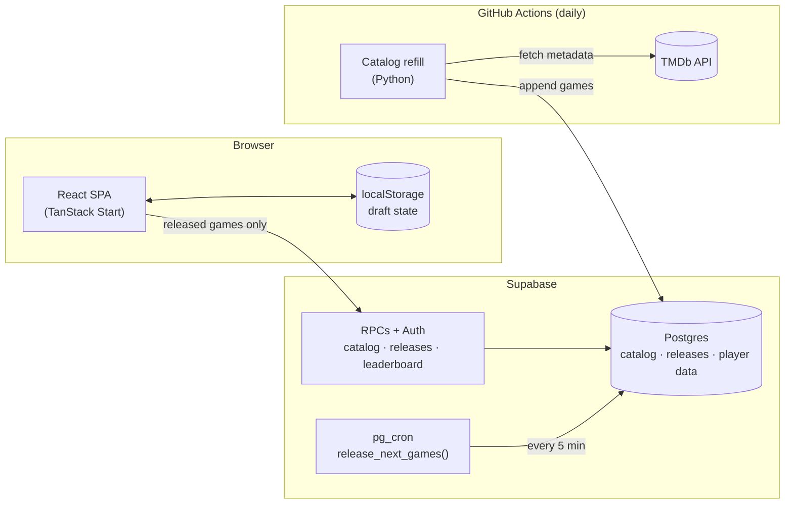

# kino.wtf

Daily movie trivia for film fans. Guess the actor, the movie, or the director from hints that reveal one at a time, Wordle-style.

**Play at [kino.wtf](https://kino.wtf)**

## Game modes

| Mode      | New game | You guess from                                          |
| --------- | -------- | ------------------------------------------------------- |
| Actors    | Daily    | Their top acting credits, in reverse order, plus trivia |
| Movies    | Daily    | The top-billed cast, in reverse order, plus trivia      |
| Directors | Weekly   | Their top directing credits, plus trivia                |

Six guesses per game. Results are shareable, stats and streaks are tracked, and every past game stays playable in the archive. You can play without an account. Signing in syncs progress across devices and puts you on the leaderboards.

## How it's built

- **The frontend is local-first.** A prerendered React SPA (TanStack Start, Tailwind, DaisyUI) hosted on Vercel. Game progress is saved in the browser, so playing never depends on an account. When a player signs in, Supabase becomes the source of truth and local state acts as a draft cache.
- **Future games never reach the browser.** The catalog lives in Postgres, not in the JS bundle. Clients read it through a `security definer` RPC that only returns released games, so upcoming answers can't be scraped.
- **Games are released by index, not by date.** A `pg_cron` job releases each mode's next game once per period (midnight, Mountain Time), and only if that game exists. If the content pipeline stalls, the current game simply stays up and numbering resumes where it left off, with no holes in the archive. This replaced an earlier calendar-based scheme after a 2026 outage left a three-month gap.
- **Content pipeline.** Answers come from curated IMDb lists. A Python job enriches them with TMDb metadata and appends them to the catalog, keeping about two weeks of daily games (and eight weeks of weekly ones) in reserve. It runs daily in GitHub Actions and alerts when the reserve runs low.
- **The catalog is append-only.** Database triggers block updates and deletes on the catalog and release tables, and every catalog insert is copied to a history table, so published games can't be silently rewritten.
- **Accounts and leaderboards.** Supabase Auth with email and OAuth. Row-level security scopes every player table to its owner. Leaderboards are computed in Postgres through RPCs.

More detail in [docs/ARCHITECTURE.md](docs/ARCHITECTURE.md).

## Tech stack

- **Frontend:** TanStack Start and Router, React 19, TypeScript, Vite, Tailwind CSS v4, DaisyUI
- **Backend:** Supabase (Postgres, Auth, RPCs, pg_cron, row-level security)
- **Data pipeline:** Python, TMDb API, GitHub Actions
- **Quality:** Vitest (including SQL migration tests on PGlite), ESLint, Prettier, GitHub Actions CI
- **Hosting:** Vercel

## Documentation

| Doc                                                       | What's in it                                                      |
| --------------------------------------------------------- | ----------------------------------------------------------------- |
| [Architecture](docs/ARCHITECTURE.md)                      | System design, data flow, release model, state and security model |
| [Development](docs/DEVELOPMENT.md)                        | Running locally, scripts, environment, project structure          |
| [Supabase](docs/SUPABASE.md)                              | Schema and migrations, auth providers, email templates, test data |
| [Game data pipeline](get_games/README.md)                 | Generating games, buffer checks, scheduled refills                |
| [Migrations runbook](supabase/migrations/README.md)       | Applying migrations and recovering catalog data                   |
| [Project spec](docs/PROJECT_SPEC.md)                      | Module boundaries, conventions, and decision log                  |
| [Contributing](CONTRIBUTING.md) · [Security](SECURITY.md) | How to contribute and report issues                               |

## Credits

- Seed lists curated on IMDb: [actors](https://www.imdb.com/list/ls4153445038/), [movies](https://www.imdb.com/list/ls4152948888/), [directors](https://www.imdb.com/list/ls4152948412/)
- Metadata from the [TMDb API](https://developer.themoviedb.org/reference/intro/getting-started). This product uses the TMDb API but is not endorsed or certified by TMDb.

## License

[MIT](LICENSE)
