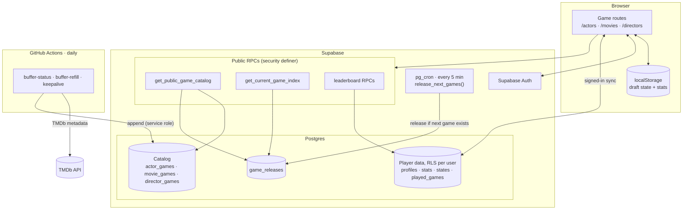
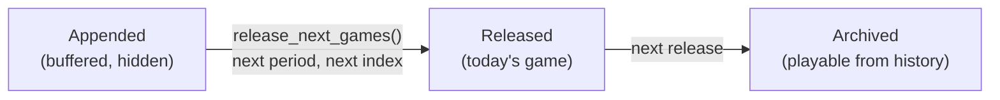

# Architecture

kino.wtf is a static, prerendered React app backed by Supabase. Gameplay runs in the browser; Supabase stores the game catalog, decides which games are released, and holds account data. A scheduled Python job keeps the catalog stocked.

For code-level conventions (module boundaries, indexing rules, anti-patterns), see [PROJECT_SPEC.md](PROJECT_SPEC.md).

## System overview

## Components

| Component        | Where                                                        | Responsibility                                                                                |
| ---------------- | ------------------------------------------------------------ | --------------------------------------------------------------------------------------------- |
| SPA              | `src/`                                                       | Routes, gameplay, history/archive, auth UI. Prerendered at build time and served from Vercel. |
| Game catalog     | `actor_games`, `movie_games`, `director_games`               | One row per game (`game_index`, `game_data` JSON). Append-only, with insert history.          |
| Release log      | `game_releases`                                              | Which `game_index` went live on which date, per mode. Defines "today's game".                 |
| Release job      | `release_next_games()` + pg_cron                             | Releases at most one new game per mode per period, only if it exists in the catalog.          |
| Player data      | `user_profiles`, `game_stats`, `game_states`, `played_games` | Account-backed stats, in-progress games, and the played-game archive.                         |
| Content pipeline | `get_games/`, `.github/workflows/game-catalog-buffer.yml`    | Generates games from IMDb seed lists + TMDb and appends them to the catalog.                  |

## Game releases

A game goes through three states:

1. **Appended.** The refill job inserts new rows with the next free `game_index`. They're invisible to players: every public read is capped at the latest released index.
2. **Released.** Every 5 minutes, pg_cron calls `release_next_games()`. For each mode, if nothing has been released in the current period and the next `game_index` exists, it records a release for this period.
   - Periods are calendar days (actors, movies) or Monday-starting weeks (directors), at midnight `America/Denver`. The same constant lives in `release_period_for_mode` (SQL) and `GAME_RELEASE_TIME_ZONE` (`src/lib/gameRelease.ts`), which the countdown uses.
   - At most one game per mode per period. A long pause never bulk-releases the buffer.
3. **Archived.** Once the next game is released, the previous one is reachable through the history modal or `?game=N`.

**Why releases are index-based.** The first version derived the current game from the calendar (days since 2025-12-31). When the refill workflow was silently disabled in June 2026, the calendar kept advancing past the end of the catalog, and the site showed "Day #318 is not available yet" with Days #233–#317 permanently missing. With a release log, an empty catalog pauses the sequence instead: the last game stays up, and when the refill resumes the next game is #233. The calendar-era history was backfilled into `game_releases` with its original dates.

## Keeping the catalog stocked

`.github/workflows/game-catalog-buffer.yml` runs daily:

| Job             | What it does                                                                                                                                      |
| --------------- | ------------------------------------------------------------------------------------------------------------------------------------------------- |
| `buffer-status` | Compares each mode's latest released index with its max catalog index. Fails (and emails) if any mode has less than 14 days / 8 weeks in reserve. |
| `buffer-refill` | Appends up to 50 actors, 50 movies, and 20 directors for any mode below threshold.                                                                |
| `keepalive`     | Re-enables the workflow through the GitHub API, which resets GitHub's 60-day inactivity timer for scheduled workflows.                            |

Because releases only advance when a game exists, a broken refill degrades gracefully: the reserve drains over two weeks (with daily failure emails), then the current game stays up until content arrives. See [get_games/README.md](../get_games/README.md) for running the pipeline by hand.

## Loading a game

1. The route (`/actors`, `/movies`, `/directors`) asks `get_current_game_index` for the latest released index. `?game=N` selects an older game, clamped to the released range.
2. It loads the catalog through `get_public_game_catalog`, which returns released games only.
3. `useGame` runs the game. Today's game is the last released entry, which also decides leaderboard eligibility: only today's game counts toward leaderboards; archive plays don't.

## State model

| State            | Where                       | Role                                                                                             |
| ---------------- | --------------------------- | ------------------------------------------------------------------------------------------------ |
| Draft game state | localStorage, per mode      | Guesses for the selected game. Discarded when it belongs to a different `game_index`.            |
| Local stats      | localStorage, per mode      | Played/won/streaks for anonymous players.                                                        |
| Remote state     | `game_states`, `game_stats` | Canonical once signed in. Sync logic never overwrites fresher remote data with a stale draft.    |
| Archive          | `played_games`              | One row per finished game. Played/won totals are counted from rows, never from index arithmetic. |

Players can play everything without Supabase configured; auth and sync degrade to local-only.

## Security model

- **Row-level security** on every player table, with policies scoped to `auth.uid()`.
- **No direct table access to the catalog or release log** from clients. Reads go through `security definer` RPCs that enforce the release bound; `release_next_games()` is not executable by `anon` or `authenticated`.
- **Service role only in CI.** The refill job holds the service-role key as a GitHub secret; the browser only ever has the anon key.
- **Append-only history.** Triggers block `UPDATE`/`DELETE` on catalog and release tables; catalog inserts are archived to `game_catalog_row_history`, and blocked truncates snapshot the table first. Recovery steps are in the [migrations runbook](../supabase/migrations/README.md).

## Testing

- `src/**/*.test.ts`: unit tests (helpers, release countdown across time zones and DST).
- `supabase/tests/*.test.ts`: migration tests that run the real SQL on [PGlite](https://pglite.dev) (in-memory Postgres): backfill, outage, recovery at the next index, period boundaries, the public read bound, and re-running the migration.
- CI (`.github/workflows/ci.yml`) runs lint, tests, and the production build on every pull request.
